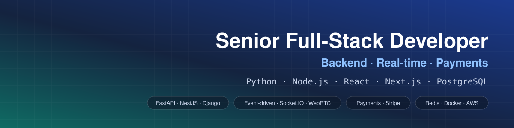

  
 <pre> $ ./kiril --init [ok] loading coffee.exe ......... done [ok] loading python.exe ......... done [ok] loading patience.exe ....... done (retry x3) &gt; whoami Kiril Fediukin &gt; title Senior Full-Stack Developer &gt; focus Backend services, real-time systems &amp; payments &gt; location Lviv, Ukraine &gt; experience 5+ years STACK language → Python · TypeScript · JavaScript · C · C++ web → React · Next.js · React Native · Redux · Ant Design server → FastAPI · LiteStar · Django/DRF · Flask · Node.js · NestJS · Express api → REST · GraphQL · Socket.IO · WebRTC data → PostgreSQL · MySQL · MS SQL · MongoDB · Redis · SQLAlchemy · Alembic payments → Stripe · payment modules · 15+ third-party integrations auth → JWT · OAuth · SSO · RBAC cloud → AWS · Google Cloud · Docker · CI/CD HIGHLIGHTS → led a monolith → event-driven services move, order-processing latency down ~40% → key endpoint response time 800 ms → 250 ms (PostgreSQL indexing, Redis caching) → test coverage 45% → 80%, CI/CD setup, GDPR requirements → mentored 3 engineers, code reviews, design discussions EXPERIENCE Mega Software → Senior / Middle Full Stack Developer (2024 – 2026) Sediya Labs → Middle / Junior Full Stack Developer (2021 – 2024) PROJECTS AlviBeauty → beauty service booking &amp; management platform (Node.js, React Native, Stripe) Logistics SaaS → logistics management &amp; business automation system (TypeScript, React, Redis, Docker) EDUCATION Ivan Franko National University of Lviv → M.Sc. &amp; B.Sc., Computer Software Engineering CONTACT linkedin → linkedin.com/in/kirilfediukin-3b5647450 email → fedyukinkirill0900@gmail.com </pre>
